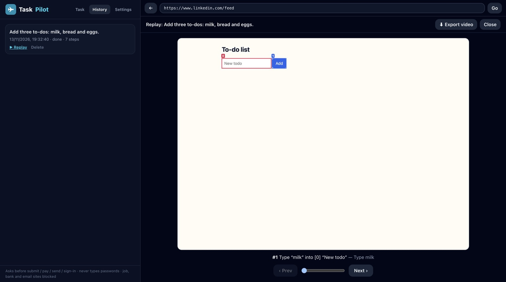

# TaskPilot

**Website + download:** https://task-pilot-jateen.netlify.app · [](https://github.com/jateenyadav/task-pilot/actions/workflows/ci.yml)

A desktop browser agent that asks before anything risky.

Type a task. TaskPilot opens **its own browser**, looks at the page, and clicks, types and scrolls until
it's done, with a live step log. Before it submits, pays, sends or signs in, it stops and asks you. Every
run is saved for replay and can be exported as a video. It uses your own free Gemini key.



## Safety, enforced in code ([`electron/agent/safety.mjs`](electron/agent/safety.mjs))
- **Asks first.** Clicks on submit / pay / buy / send / sign-in / delete-like elements, and Enter inside a
  form, wait for your Yes.
- **Never types secrets.** Password, OTP, card, CVV, Aadhaar and PAN fields are refused, and so is text
  that looks like a card or ID number.
- **Keeps away from risky sites.** Job portals, banks, payment and email sites are blocked by default and
  can only be allowed in Settings. **LinkedIn is always blocked.** Every navigation is checked (link
  clicks, redirects, pop-ups, typed addresses), not just the agent's own `goto`.
- **Its own browser.** A separate Electron session with no access to your real logins. Downloads, pop-up
  windows, camera, microphone, location and notifications are all denied.
- **Kill switches.** A Stop button, Esc, a 25-step limit, and an automatic stop when the same action
  repeats without progress.
- **Page text is data.** The prompt says so, and the practice table page contains a planted
  "ignore all previous instructions" line to test it.
- **Your key** is stored with Electron `safeStorage` (the system keychain) and only sent to Google.

## How it works
```
UI (React, sandboxed) ──IPC──▶ main process ──CDP──▶ agent browser view (own session, locked down)
                                   │  observe: list visible interactive elements, draw numbered boxes
                                   │           ("set-of-marks"), screenshot, remove boxes
                                   │  decide:  Gemini 2.5 Flash ← screenshot + element list + task + last 8 steps
                                   │           → one zod-checked JSON action (click / type / scroll / key / goto / wait / done / ask)
                                   │  review:  safety rules → allow · ask you · refuse (explained to the model)
                                   └  act:     CDP mouse / keyboard / insertText; save the step for replay
```
The numbered boxes let a free vision model point at element `7` instead of guessing pixel coordinates.
The loop ([`electron/agent/loop.mjs`](electron/agent/loop.mjs)) has no Electron dependency, so it is
unit-tested with a fake browser and a fake brain.

## Measured results
`npm run bench` runs 10 tasks on bundled practice sites in [`bench/sites`](bench/sites): a to-do list,
shop search, a form, a table lookup, a multi-page wiki, checkboxes, pagination, a dropdown and radio, a
long scroll, and tabs. Each task has an automatic success check
([`bench/tasks.mjs`](bench/tasks.mjs)), and the results go in `docs/benchmark.md`. *(Not run yet: this
needs a real Gemini key. No numbers are shown until there is a real run.)*

## Run it
Download the app from [Releases](https://github.com/jateenyadav/task-pilot/releases/latest). It isn't
code-signed yet: on a Mac, right-click → Open the first time; on Windows, choose "More info → Run
anyway". Or run it from source:
```bash
npm install
npm run build && npm start   # or `npm run dev` for hot reload
npm test             # 12 unit tests (safety rules, agent loop, brain parsing)
npm run test:e2e     # Playwright launches the real app; a fake AI drives it through a task
npm run bench        # the 10-task benchmark (needs your Gemini key in Settings or GEMINI_API_KEY)
npm run dist         # build an installer for this computer
```

## Credits
Inspired by [simular-ai/Agent-S](https://github.com/simular-ai/Agent-S). This is an independent
implementation. The practice sites and their content are made up.

## License
MIT
